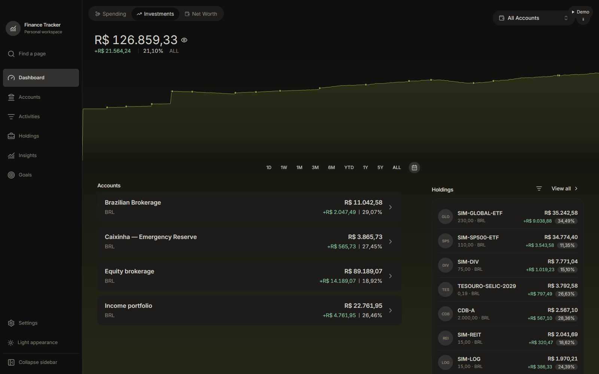
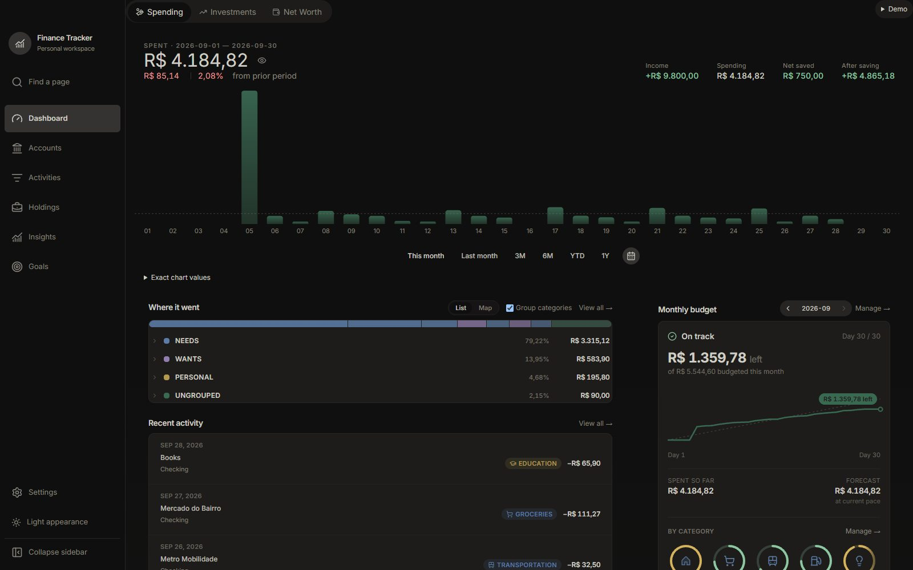
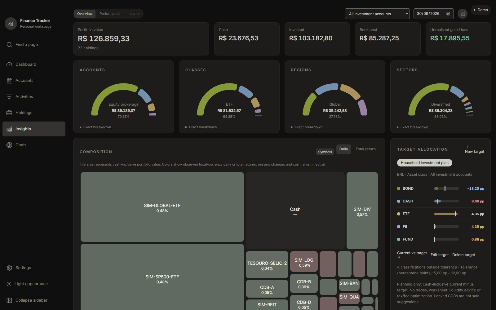
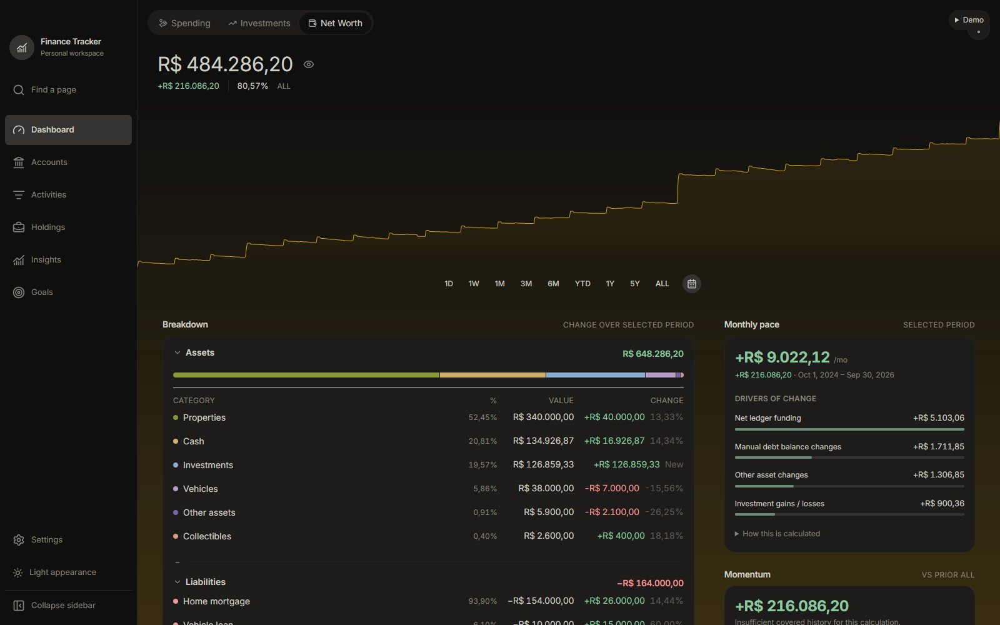

# Finance Tracker

[](https://github.com/GabrielTeixeira88/Finance-Tracker/actions/workflows/ci.yml?query=branch%3Amain)

A **local-first, single-user personal finance and investment application** built
with React/TypeScript, FastAPI and SQLite. It connects household spending, investment
activities, historical valuations, budgets and savings goals through one exact
financial ledger. Core operation needs no cloud service or database server.

This software engineering portfolio project emphasizes financial domain modeling,
transaction integrity, ingestion and historical analytics. Current source milestone:
**0.14.0**. No v0.14 release tag or public deployment is implied.

[Two-minute walkthrough](docs/PORTFOLIO_WALKTHROUGH.md) |
[Recorded demo](docs/screenshots/v014/walkthrough.webm) |
[Architecture](docs/architecture.md) | [Data model](docs/DATA_MODEL.md)

## Visual preview

Actual v0.14 application, captured at 1600 x 1000 using the isolated fictional demo.
Official CDI/Treasury inputs and simulated security prices retain separate provenance;
these are not a real investor's results. Click a thumbnail for the full-size image.

| Investments overview                                                                                                                  | Spending and budgeting                                                                                               |
| ------------------------------------------------------------------------------------------------------------------------------------- | -------------------------------------------------------------------------------------------------------------------- |
| [](docs/screenshots/v014/investments.jpg) | [](docs/screenshots/v014/spending.jpg) |
| Portfolio Insights                                                                                                                    | Net Worth                                                                                                            |
| [](docs/screenshots/v014/portfolio-insights.jpg) | [](docs/screenshots/v014/net-worth.jpg)    |

[Full gallery: Holdings, Performance, Goals, Activities, Budgets and Income](docs/screenshots/v014/README.md).
Older v0.12 images remain historical records, not the current preview.

## Key features

- **Spending and budgets:** category targets, effective-month changes, overrides,
  signed rollover, linked refunds and Life Events.
- **Accounts and transactions:** opening history, atomic transfers, normalized
  payees, review states, combined filters and page-scoped bulk metadata changes.
- **Investments and analytics:** activity-derived holdings, weighted-average cost,
  realized/unrealized gains, TWR/XIRR, labeled comparisons and historical coverage.
- **Brazilian fixed income:** CDB, RDB/Caixinha and Tesouro Selic contracts, historical
  CDI accrual/official Treasury valuation and separately disclosed redemption estimates.
- **Net Worth and Goals:** accounts, holdings and dated manual assets/debts counted
  once; goals reserve existing savings instead of creating assets.
- **Reviewed ingestion:** CSV/OFX preview, identity/duplicate decisions, source
  provenance and explicit atomic posting; reconciliation retains correction history.
- **Optional integrations:** read-only Gmail and Pluggy adapters, secure OS-vault
  credentials and explicit review. The demo uses neither real mailboxes nor live banks.
- **Local configuration:** appearance/language, account groups, allocation targets
  (no trades), whitelisted exports and maintenance-only personal backup/restore.

Reports remains a labeled read-only preview. Full rebalancing, tax-lot/options
engines, automatic posting, cloud sync, authentication and AI are not implemented.
Live OAuth/bank-provider validation and entitlements remain separate from demo coverage.

## Engineering highlights

| Problem                       | Implementation                                                                                                                                                                                                                           |
| ----------------------------- | ---------------------------------------------------------------------------------------------------------------------------------------------------------------------------------------------------------------------------------------- |
| Exact financial arithmetic    | Python `Decimal`, an exact TEXT-backed SQLAlchemy money adapter, decimal-string API values and BigInt display normalization. Monetary aggregation avoids SQLite REAL/NUMERIC and JavaScript Number.                                      |
| Reconstructible balances      | Transactions and investment cash postings reconstruct cash; linked transfer sides commit together under foreign keys/triggers. Transfers/openings do not inflate personal income or spending.                                            |
| Investment accounting         | Activities reconstruct weighted-average positions in stable date/sequence order. Oversells/unfunded activity are rejected; void-and-replace corrections retain history. Cash, basis, gains and income share these services.              |
| Meaningful historical returns | Dated quantities, eligible prices and FX feed valuations. Daily TWR separates external flows; XIRR uses dated cashflows. Missing/stale/corporate-action coverage stays unavailable, not zero or fabricated performance.                  |
| Fixed-income semantics        | Dated CDI factors or contractual fixed rates accrue CDB/RDB lots; Treasury uses the identified instrument's dated unit prices. Gross value, estimated IR/IOF and net redemption are distinct; accrued interest is not paid cash income.  |
| Reliable imports              | Parsing -> validation -> preview -> identity/duplicate review -> explicit posting. Parsers cannot post; immutable source identities, many-source links and atomic confirmation prevent silent duplicate movements.                       |
| Local durability              | SQLite foreign keys, WAL, synchronous FULL, bounded lock waits and explicit request transactions. SQLAlchemy centralizes persistence; Alembic versions schema and integrity triggers. One local writer process is the intended tradeoff. |
| Validation                    | Pytest financial/migration/integrity/isolation tests, Vitest component/adapter tests, Playwright real-API workflows, Ruff, ESLint, Prettier, TypeScript and production dependency checks. CI installs from locked dependencies.          |

Explore [domain architecture](docs/architecture.md), [ingestion](docs/IMPORTS.md),
[analytics conventions](docs/INVESTMENT_ANALYTICS.md), [fixed income](docs/FIXED_INCOME.md)
and [testing commands](docs/TESTING.md). The recorded comprehensive audit's
573 backend / 330 frontend test results are historical; current CI is linked above.

## Architecture

```text
React / TypeScript / TanStack Query
              | exact-string JSON, local /api
FastAPI / Pydantic -> domain posting and read-only projections
              | SQLAlchemy request transaction
          local SQLite + Alembic

CSV / OFX / optional adapters -> candidates -> user review -> ledger services
```

The backend owns financial truth. Frontend adapters translate API shapes into
presentation components. External providers stay behind opt-in adapters; no Redis,
Celery, hosted database or telemetry is required. SQLite suits a single local user;
it is not presented as a shared writable web service.

## Try the complete fictional demo

Prerequisites: Python 3.12+ (validated with 3.13), uv, Node 22.13+ or 24+, npm.
From the repository root:

```sh
cd frontend
npm ci
npm run build
cd ../backend
uv sync --frozen
uv run python -m app.demo
```

Open **http://127.0.0.1:8001**. No credentials, Docker or live market calls are needed.
Spending is the initial Dashboard tab; choose **Investments** for the portfolio chart.
One unified workspace includes household spending/budgets, seven goals, house/car,
official fixed-income inputs, fictional SIM securities and 135 income payments.

Startup prepares an owned demo once and resumes edits on later launches. **Demo |
Reset demo** restores only that isolated demo after confirmation. Never point a
seed/reset command at personal data. Stop with Ctrl+C. PowerShell users can use
`npm.cmd`; deactivate an unrelated Python environment before `uv sync` / `uv run`.

[Demo safety and lifecycle](docs/DEMO.md) |
[120-second walkthrough](docs/PORTFOLIO_WALKTHROUGH.md) |
[Historical data sources](docs/REAL_MARKET_DEMO.md)

Official WRLD11/IVVB11 history still needs an authorized private export. SIM
identifiers and prices are fictional and never masquerade as those real ETFs.

## Run your normal local workspace

Terminal 1, from the repository root:

```sh
cd backend
uv sync --frozen
uv run alembic upgrade head
uv run uvicorn app.main:app --host 127.0.0.1 --port 8000
```

Terminal 2:

```sh
cd frontend
npm ci
npm run dev
```

Open http://127.0.0.1:5173. API docs: http://127.0.0.1:8000/docs.
Vite proxies `/api` locally. Optional `.env` settings come from `.env.example`.
`DATABASE_PATH` defaults to `data/finance-tracker.db`, relative to the repository root.
SQLite uses foreign keys, WAL, synchronous FULL and a five-second busy timeout.
Keep files on a local disk, bind to loopback, and never expose this unauthenticated
personal application publicly.

Normal startup never seeds or resets data. Existing databases require migrations,
not replacement. Legacy `app.seed_demo`, `app.seed_spending_demo`,
`app.seed_investment_demo`, `app.seed_market_demo`, `app.seed_analytics_demo` and
`app.seed_wealth_demo` remain available for their older empty-database fixtures;
prefer the isolated demo command for a cohesive showcase. Do not point legacy seeds
at personal data. PostgreSQL is not required or supported by the current runtime.

## Tests and checks

[CI configuration and troubleshooting](docs/CI.md) documents backend/frontend checks,
isolated Chromium demo tests and production dependency audits. CI runs on pull requests
to `main`, pushes to `main` / `feature/**`, and manual dispatch; it never deploys.

From `backend/`:

```sh
uv run pytest
uv run ruff check .
uv run ruff format --check .
```

Tests migrate isolated temporary databases, including fresh and populated migration
regressions. To check drift on your migrated local database: `uv run alembic check`.

From `frontend/`:

```sh
npm test
npm run lint
npm run format:check
npm run build
npm run test:demo
```

The build includes TypeScript checking. The demo browser runner requires Edge by
default; set `BROWSER_CHANNEL=chrome` for installed Chrome, or install Playwright
Chromium and set `BROWSER_CHANNEL=chromium`. It starts its own migrated temporary
workspace and refuses an occupied port 8001. If your saved demo is running, set
`DEMO_E2E_PORT=5174` for tests instead (PowerShell: `$env:DEMO_E2E_PORT="5174"`). It never resets the normal or saved
local demo. The legacy `--screenshots` flag writes historical v0.12 evidence. Use the dedicated
[v0.14 portfolio capture workflow](docs/screenshots/v014/README.md#reproduce-the-gallery) for the current gallery.

## Storage, privacy and deployment

Databases/WAL/SHM, backups, financial files, credentials, dependencies and build
artifacts are ignored. Use SQLite's backup API for a live consistent copy; copying
only a database file while writers are active is unsafe. Never reset personal data.
Optional Docker packaging remains `docker compose up --build -d --wait` with
loopback-bound ports; it is not required for native operation or the demo.

**No public demo URL exists.** A shared writable server is not a substitute for
session isolation. See the [deployment decision](docs/DEMO_DEPLOYMENT.md).

## Project status and licensing

v0.14 integrates the current frontend, unified demo and backend compatibility
projections. See [finalization](docs/FINALIZATION_V014.md), [roadmap](docs/ROADMAP.md)
and [changelog](CHANGELOG.md). Postponed financial engines remain postponed;
a milestone number does not establish production readiness.

Owner-authored code is **AGPL-3.0-only**: [LICENSE](LICENSE), [NOTICE](NOTICE.md)
and [third-party notices](THIRD_PARTY_NOTICES.md). The frontend directly adapts
licensed Wealthfolio source/components and interaction patterns; it was not
independently designed from scratch. Finance Tracker's own work includes the
FastAPI/SQLite domain services, exact-money adapters, ingestion pipelines,
Brazilian-product integration and validation. Wealthfolio is a trademark of
Teymz Inc.; this project is neither official nor endorsed by its authors.

Third-party AGPL/GPL/MIT/OFL software and data retain their terms. Read
[source-access obligations](frontend/public/licenses/SOURCE_ACCESS.md) for exact
compiled/network distributions. These do not require publishing private databases
or credentials. The documented development-only minimatch risk is accepted for
this milestone, not fixed; see [security review](docs/DEPENDENCY_SECURITY_V014.md).
