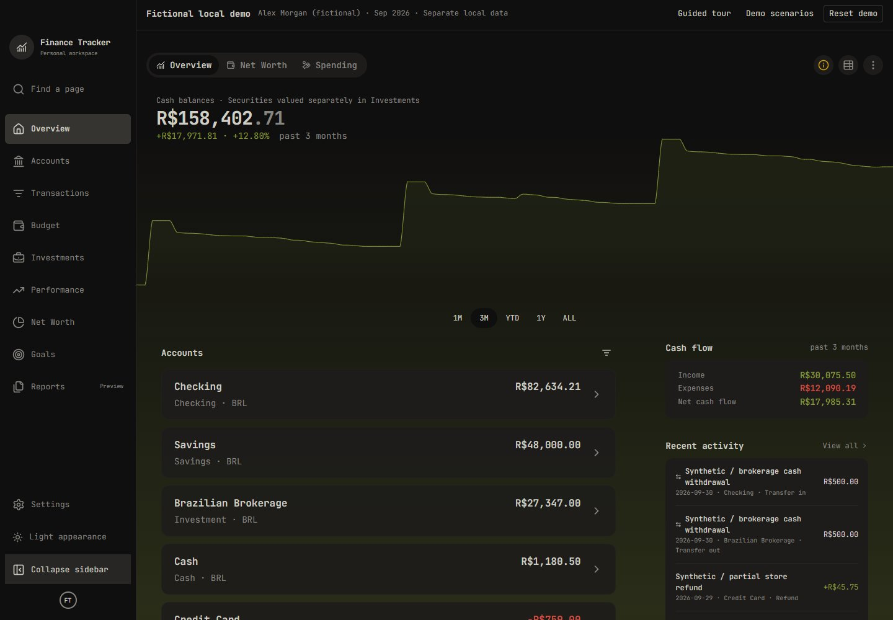
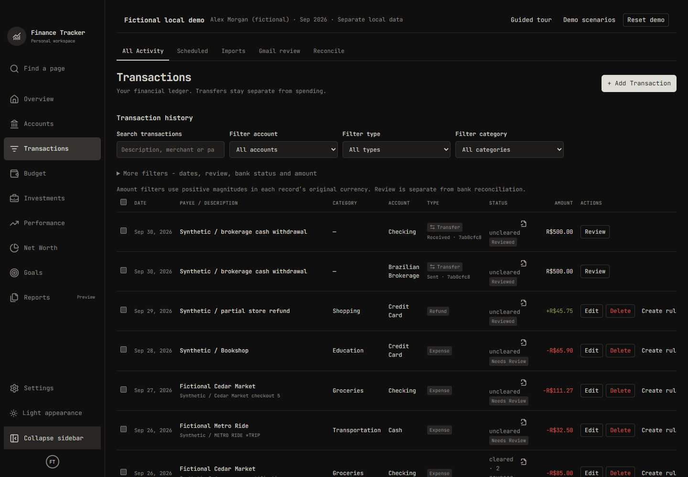
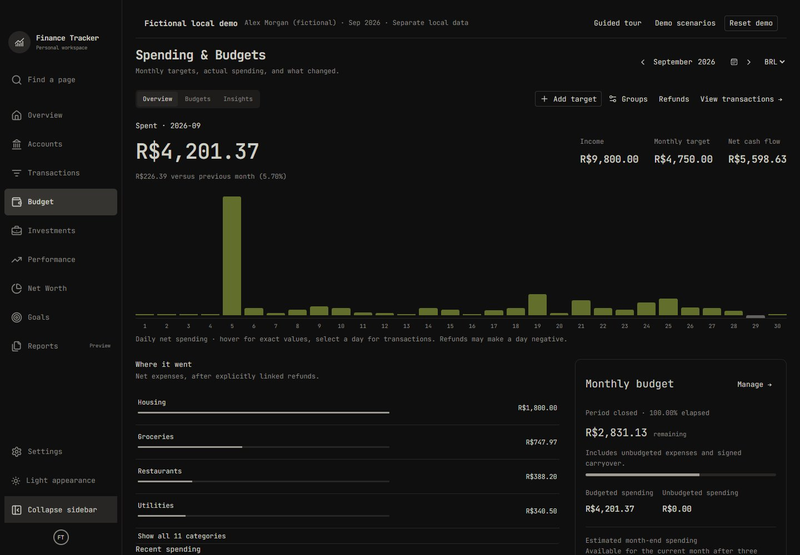
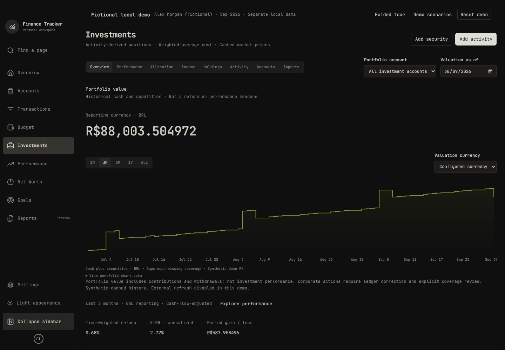
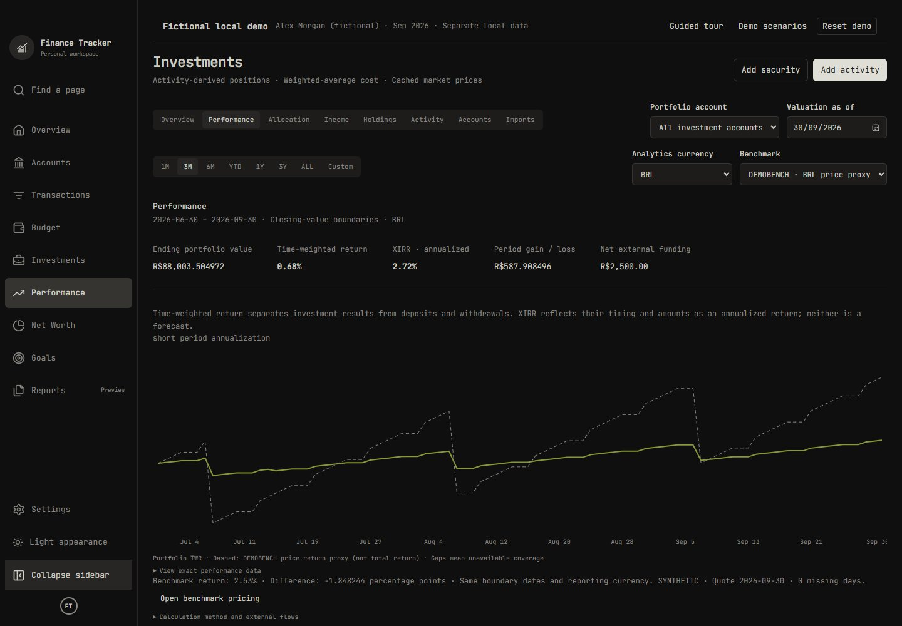
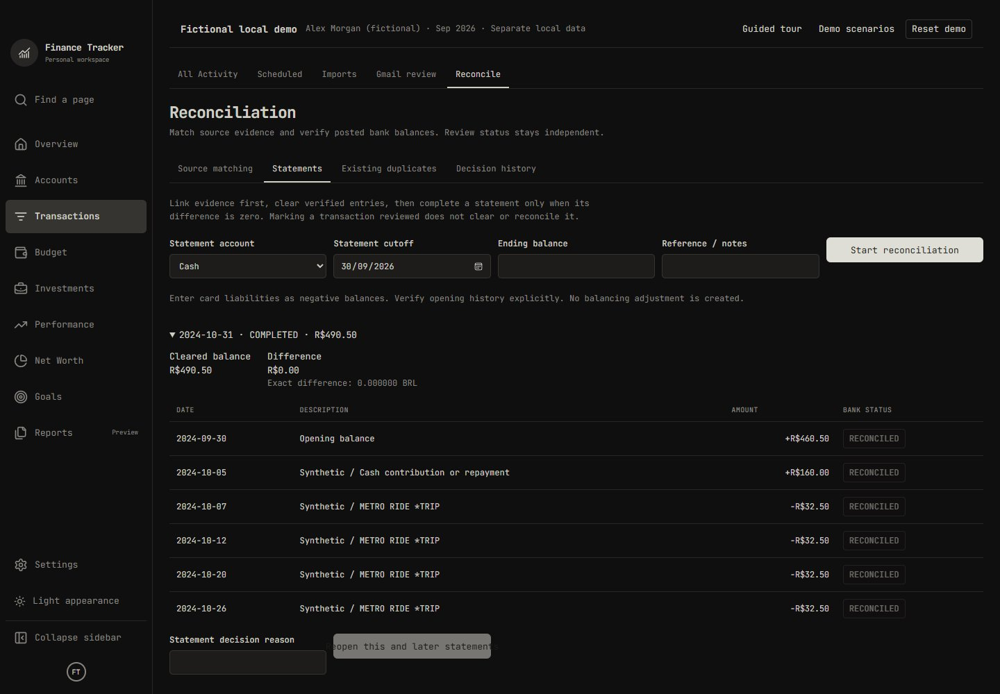
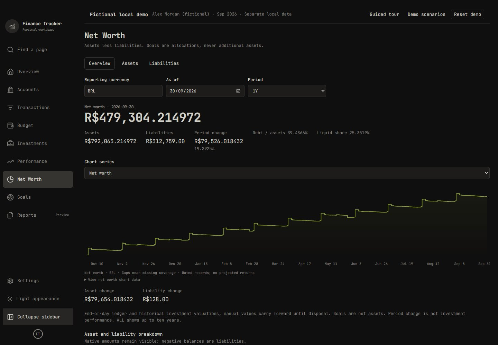
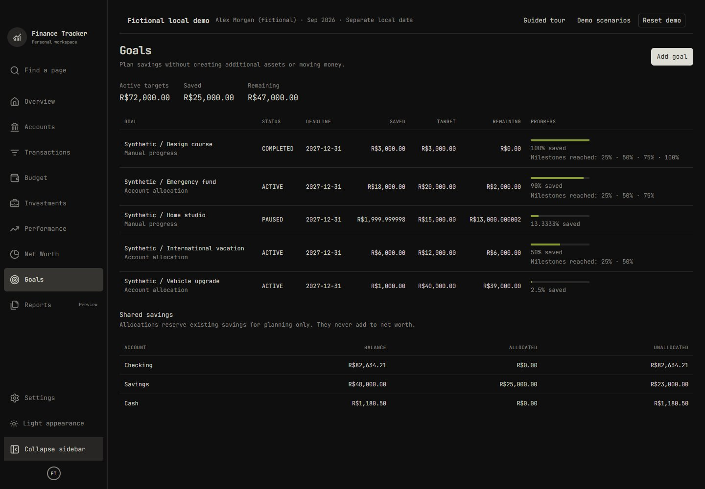

# Finance Tracker

[](https://github.com/GabrielTeixeira88/Finance-Tracker/actions/workflows/ci.yml?query=branch%3Afeature%2Fv0.13.0-stabilization)

A local-first personal finance and investment application: understand spending,
manage transactions, reconstruct holdings, and track net worth in one private workspace.
React and FastAPI share a real SQLite ledger; exact money and auditable history take
priority over automatic guesses.

**Version: 0.12.0 - Interactive Demo & Portfolio Showcase.**
The demo runs locally; no public deployment has been published.



## Try the fictional demo

Explore **Alex Morgan**, a fictional household with two years of history. No account,
API key, OAuth setup, cloud service or Docker is needed. This runs a separate local
workspace; it does not change your normal database or its configuration.

Prerequisites: Python 3.12+ (validated with 3.13), uv, Node 22.13+ or 24+, npm.
From the repository root:

```sh
cd frontend
npm ci
npm run build
cd ../backend
uv sync --frozen
uv run python -m app.demo
```

Open **http://127.0.0.1:8001**. Startup applies migrations, builds the fictional
baseline once, and resumes your demo edits on later launches. **Reset demo** restores
only the isolated demo after confirmation. Stop with Ctrl+C. To use personal data,
start the normal application below; there is no live database-switching toggle.
PowerShell users can use `npm.cmd` if script execution is restricted. If another
virtual environment is active, deactivate it before `uv sync` / `uv run`.

[Demo setup and safety](docs/DEMO.md) | [Five-minute walkthrough](docs/PORTFOLIO_WALKTHROUGH.md)
| [Hosting design and limitations](docs/DEMO_DEPLOYMENT.md)

## What you can explore

| Area | Implemented behavior |
|---|---|
| Transactions | Accounts, openings, exact income/expenses, linked transfers, payees, review, search, pagination and atomic bulk metadata edits |
| Automation | Classification rules with manual-override protection, approved learning suggestions, expected schedules with explicit posting/matching |
| Spending & budgets | Monthly category targets, overrides, signed rollover, comparisons and linked refunds |
| Ingestion | Local CSV/OFX mapping, preview/confirmation, duplicate decisions and retained source evidence |
| Reconciliation | Identity-first matching, clearing, statements and audited source corrections |
| Investments | Activity-derived holdings, weighted-average basis, dated prices/FX, TWR, XIRR, labeled benchmark comparisons and coverage |
| Net worth & goals | Ledger cash/holdings plus dated assets/debts; allocations of existing savings, without double-counting |
| Demo | 24 months, 772 ledger entries, 7 accounts, fictional prices/FX, safe reset, notification simulation and a guided tour |

**Reports remains a labeled preview.** Gmail adapters exist, but live Google OAuth
and real bank templates remain unverified; the demo uses **Gmail Notification
Simulation**, never a real mailbox. External market requests are opt-in in normal
mode and disabled in the demo. No authentication, cloud sync or telemetry is included.

<details>
<summary>More real application screenshots - synthetic data only</summary>









</details>

## Run your normal local workspace

Terminal 1, from the repository root:

```sh
cd backend
uv sync --frozen
uv run alembic upgrade head
uv run uvicorn app.main:app --host 127.0.0.1 --port 8000
```

Terminal 2:

```sh
cd frontend
npm ci
npm run dev
```

Open http://127.0.0.1:5173. API docs: http://127.0.0.1:8000/docs.
Vite proxies `/api` locally. Optional `.env` settings come from `.env.example`.
`DATABASE_PATH` defaults to `data/finance-tracker.db`, relative to the repository root.
SQLite uses foreign keys, WAL, synchronous FULL and a five-second busy timeout.
Keep files on a local disk, bind to loopback, and never expose this unauthenticated
personal application publicly.

Normal startup never seeds or resets data. Existing databases require migrations,
not replacement. Legacy `app.seed_demo`, `app.seed_spending_demo`,
`app.seed_investment_demo`, `app.seed_market_demo`, `app.seed_analytics_demo` and
`app.seed_wealth_demo` remain available for their older empty-database fixtures;
prefer the isolated demo command for a cohesive showcase. Do not point legacy seeds
at personal data. PostgreSQL is not required or supported by the current runtime.

## Architecture and financial safeguards

```text
React / TanStack Query -> local FastAPI -> domain services -> SQLAlchemy -> SQLite
                                             ^
                         parsers -> review -> explicit confirmation
```

Money crosses the API as exact decimal strings. SQLite uses the exact storage
adapter rather than floating-point NUMERIC arithmetic. Ledger entries determine
cash; investment activities determine positions. Transfers and openings are excluded
from personal cash flow. Imports never post until confirmed. Goals never add assets.
Missing price/FX coverage stays unavailable rather than becoming zero.

Frontend: React, TypeScript, Vite, Tailwind, shadcn/ui, TanStack Query, Zod, Recharts.
Backend: Python, FastAPI, Pydantic, SQLAlchemy, Alembic, SQLite.
Validation: Pytest, Vitest, Playwright, Ruff, ESLint, Prettier, TypeScript.

[Architecture](docs/architecture.md) | [Data model](docs/DATA_MODEL.md) |
[Product scope](docs/PRODUCT_SPEC.md) | [UI conventions](docs/UI_FOUNDATION.md) |
[Engineering rules](AGENTS.md)

## Tests and checks

[CI configuration and troubleshooting](docs/CI.md) documents backend/frontend checks,
isolated Chromium demo tests and production dependency audits. CI runs on pull requests
to `main`, pushes to `main` / `feature/**`, and manual dispatch; it never deploys.

From `backend/`:

```sh
uv run pytest
uv run ruff check .
uv run ruff format --check .
```

Tests migrate isolated temporary databases, including fresh and populated migration
regressions. To check drift on your migrated local database: `uv run alembic check`.

From `frontend/`:

```sh
npm test
npm run lint
npm run format:check
npm run build
npm run test:demo
```

The build includes TypeScript checking. The demo browser runner requires Edge by
default; set `BROWSER_CHANNEL=chrome` for installed Chrome, or install Playwright
Chromium and set `BROWSER_CHANNEL=chromium`. It starts its own migrated temporary
workspace and refuses an occupied port 8001. If your saved demo is running, set
`DEMO_E2E_PORT=5174` for tests instead (PowerShell: `$env:DEMO_E2E_PORT="5174"`). It never resets the normal or saved
local demo. Add `-- --screenshots` to regenerate the documented synthetic screenshots.

## Storage, privacy and deployment

Databases/WAL/SHM, backups, financial files, credentials, dependencies and build
artifacts are ignored. Use SQLite's backup API for a live consistent copy; copying
only a database file while writers are active is unsafe. Never reset personal data.
Optional Docker packaging remains `docker compose up --build -d --wait` with
loopback-bound ports; it is not required for native operation or the demo.

**No public demo URL exists.** A shared writable server is not a substitute for
session isolation. See the [deployment decision](docs/DEMO_DEPLOYMENT.md).

## Roadmap and project status

v0.12 provides the isolated interactive showcase. v0.13 is Final Product Refinement, Stability, Security & Release Validation.
Its detailed scope will follow review of the populated demo: concrete UI/UX defects,
functional inconsistencies, backups, recovery, full financial audits, performance,
installation and any separately approved hosted-demo security. v1.0 requires
validated readiness; a milestone number alone does not make the application stable.

[Roadmap](docs/ROADMAP.md) | [Changelog](CHANGELOG.md) |
[Demo validation](docs/DEMO_READINESS.md) | [Current release audit](docs/RELEASE_0_12_0.md)

`backend/app/_version.py` is the canonical version, mirrored in frontend metadata.
Existing licenses and adapted-source notices remain in [LICENSE](LICENSE),
[THIRD_PARTY_NOTICES.md](THIRD_PARTY_NOTICES.md) and `frontend/public/licenses`.
