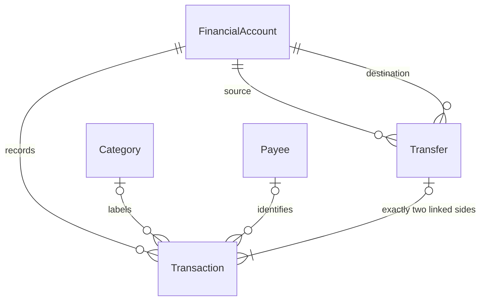
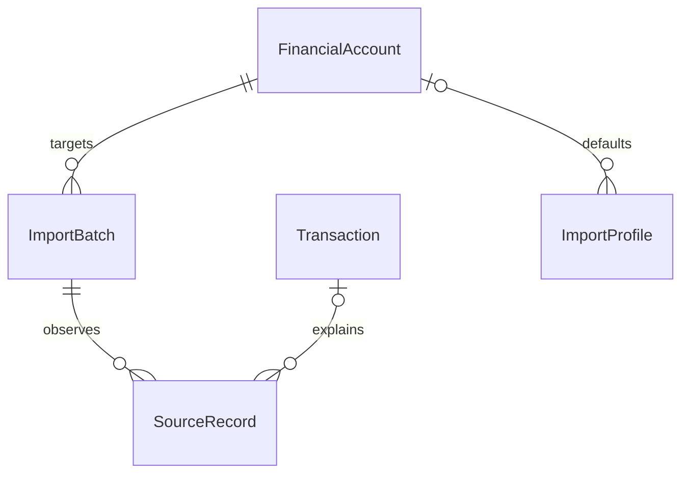
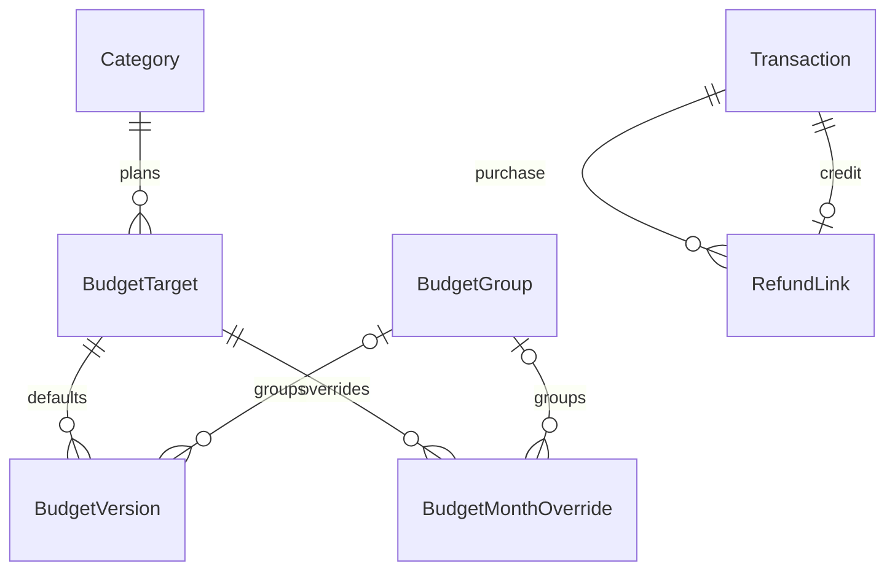
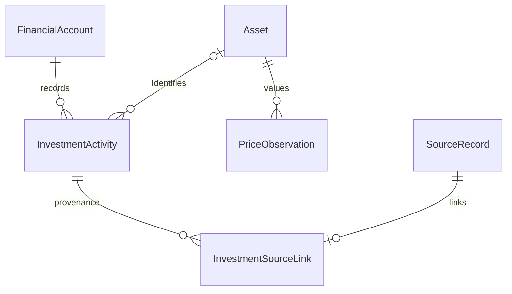

# Finance Tracker data model

Current release scope: **v0.12.0 - Interactive Demo & Portfolio Showcase**. Next: **v0.13.0 - Final Product Refinement, Stability, Security & Release Validation**. See [net-worth and goals contracts](NET_WORTH_GOALS.md), [release audit](RELEASE_0_12_0.md) and [version mapping](ROADMAP.md). Historical phase labels below describe prior implementation checkpoints.

All financial records stay in local SQLite. The ledger is authoritative; there
is no editable or cached account-balance column.



## Accounts and categories

`financial_accounts`: UUID id, name, type, three-letter uppercase currency code,
optional institution, active flag, created_at, updated_at. Supported types:

| Type | Meaning in this phase |
| --- | --- |
| CHECKING | Everyday bank account |
| SAVINGS | Savings cash account |
| CASH | Physical cash |
| CREDIT_CARD | Signed balance; debt is negative |
| INVESTMENT | Cash ledger plus activity-derived securities and manual valuation |

Currency is required by the domain and immutable through account updates. BRL is
only a frontend/demo default. ISO-style codes are shape-validated; no external
currency registry, exchange rates, or per-currency minor-unit rules are implemented.
Account deletion deactivates it. Historical balances remain in dashboard totals,
and new postings/transfers to inactive accounts are rejected. Existing ordinary
entries can still be corrected or soft-deleted on an inactive account.

`categories`: UUID id, user-defined name, created_at, updated_at. Names are unique
case-insensitively after trimming. Categories are applicable to both income and
expense, with no hierarchy. A category cannot be deleted while referenced by any
transaction, including soft-deleted history. Foreign keys enforce this as well as
the API's explicit check.

## Monetary convention

Amounts use Python `Decimal` and the SQLAlchemy `ExactMoney` adapter. SQLite stores
24 zero-padded decimal digits of millionths as TEXT (not NUMERIC/REAL). This preserves
the former NUMERIC(24,6) range without 64-bit integer overflow. Values must be finite,
strictly positive, less than 10^18, and have at most six fractional digits. APIs
require decimal **strings**, rejecting JSON numbers rather than risking float
conversion. Excess precision is rejected before persistence, not silently rounded.
Responses serialize money as strings; the frontend formats those strings directly.

Every transaction and transfer stores currency. Composite foreign keys tie it to
the referenced account's currency. No aggregation combines different currencies.
The UTCDateTime adapter restores UTC timezone information on SQLite reads; transaction dates are calendar dates with no
timezone conversion.

## Transactions and opening history

`transactions`: UUID id, account_id, transaction_type, positive amount, currency,
direction, transaction_date, description, optional merchant/category_id, optional
transfer_id, created_at, updated_at, and nullable deleted_at.

| Type | Direction | Income/expense reporting |
| --- | --- | --- |
| INCOME | IN (+) | Income |
| EXPENSE | OUT (-) | Expense |
| TRANSFER | IN or OUT according to linked side | Excluded |
| OPENING_BALANCE | IN for assets, OUT for a starting liability | Excluded |

An account creation may specify nonnegative `opening_balance`, `opening_direction`
(IN by default), and an explicit opening date. A nonzero amount creates one opening
entry atomically with the account. Zero creates no ledger entry, because ledger
amounts must be positive. A partial unique index permits at most one opening entry
per account. There is no independently editable starting-balance field.

Opening entries and transfers have immutable posting fields through both the API and
database update/delete triggers. Review metadata may change; correcting or reversing
their financial posting is intentionally deferred.
Ordinary entries can change type (income/expense), amount, date, description,
merchant, and category; their account and currency cannot be reassigned. Updates
retain id/created_at and advance updated_at, but a full revision audit is not yet
implemented. Deleting an ordinary entry sets deleted_at, preserves the row, and
excludes it from balances, lists, and reporting. Retrieve-by-id can still inspect it.
Physical transaction deletion is blocked by a database trigger.

## Transfers

`transfers`: UUID id, source_account_id, destination_account_id, positive amount,
currency, date, description, created_at, updated_at, source_entry_id, and
destination_entry_id. The entry IDs are deferred foreign keys to transactions. A transfer links exactly two
transactions through transfer_id: OUT on the source and IN on the destination.

The dedicated backend operation reserves the SQLite writer before reading accounts,
inserts the parent and both entries in one transaction, and commits once. Same-account
and cross-currency transfers are rejected. Composite foreign keys require matching
account currencies. Parent entry pointers must resolve at commit; insert triggers
validate that each side exactly matches its parent. Unique `(transfer_id, direction)`
and distinct entry ID constraints prohibit extra sides. Partial or mismatched
transfers cannot commit, including through direct database writes. All failures roll
back the whole operation. Negative balances remain valid; overdraft prevention is
not imposed.

The frontend exposes transfers only through Transactions -> Add Transaction ->
Transfer. The dedicated `/api/transfers` endpoint remains an atomic backend boundary,
not a separate product section. Categories are managed in Settings. Their stored
`normalized_name` is generated from lower(trim(name)) and uniquely indexed; this
keeps duplicate-name enforcement introspectable by SQLite/Alembic.

## Balances and dashboard

Python aggregates decoded Decimal values (never SQLite floating-point SUM).
For each account, sum non-deleted transaction IN amounts minus OUT amounts, plus
non-void investment activity cash in minus cash out, across
**all recorded dates**, including future-dated entries, for the Phase 1 accounts and
dashboard endpoints. The new history endpoint instead calculates as-of-date balances.
Legacy dashboard total account value is the sum of all-date balances,
including inactive accounts and signed credit-card liabilities, grouped by currency.
INVESTMENT accounts contribute their ledger cash balance only.

The retained `/api/dashboard` endpoint accepts a selected month as `YYYY-MM`.
Overview now uses `/api/history` instead.
The backend includes dates from that month's first day (inclusive) to the next
month's first day (exclusive). Only INCOME contributes to income and only EXPENSE
contributes to expenses. Both opening entries and transfers are excluded. Recent
transactions contain up to ten non-deleted ledger entries, including both transfer
sides. Listing supports basic filters and limit/offset pagination.

Mandatory example: Checking opening 5,000 + income 1,000 - expense 200 - transfer
500 = **5,300**. Savings opening 2,000 + transfer 500 = **2,500**. Reporting is
**1,000 income**, **200 expenses**; the transfer changes neither report total.

## API surface

All paths are under `/api`. IDs are UUIDs. Monetary request/response values are strings.

| Method | Path | Operation |
| --- | --- | --- |
| GET / POST | `/accounts` | List with calculated balances / create with optional opening |
| GET / PUT / DELETE | `/accounts/{id}` | Retrieve / update metadata and active flag / deactivate |
| GET / POST | `/categories` | List / create |
| PUT / DELETE | `/categories/{id}` | Rename / delete when unreferenced |
| GET / POST | `/transactions` | Filtered list / create INCOME or EXPENSE |
| GET / PUT / DELETE | `/transactions/{id}` | Inspect / correct ordinary entry / soft-delete |
| POST | `/transfers` | Atomically create a linked pair |
| GET | `/transfers/{id}` | Inspect the transfer relationship |
| GET | `/dashboard?month=YYYY-MM` | Currency-separated balances and monthly totals |

Transaction filters: `account_id`, `transaction_type`, `category_id`, `date_from`,
`date_to` (both inclusive), `limit` (1–200, default 100), `offset` (default 0).
PUT requests replace the documented editable fields; omitted optional merchant or
category fields clear them. Errors use 404 for missing records, 422 for invalid
input/unsupported currency operations, and 409 for immutable/referenced records or
constraint conflicts. Database exception details are not returned to the browser.

See FastAPI `/docs` for complete request and response schemas.

## Payees and review (Phase 2A)

`payees`: UUID id, name, unique normalized_name, created_at, updated_at. Names collapse
whitespace and use Unicode casefold for uniqueness/search. Punctuation and accents are
not removed; similar names are never merged automatically. There is no delete/merge API.
`transactions.payee_id` is nullable, indexed, and protected by a foreign key.
Income/expenses may reference payees; transfers/openings may not. Existing rows receive
no inferred payee. Lists show the current normalized payee name with the raw description
underneath; `description` remains independent and is never overwritten by payee assignment.

`transactions.review_status`: NOT NULL, default REVIEWED, constrained to REVIEWED or
NEEDS_REVIEW. This means user inspection only. Bank clearing and reconciliation are stored separately by v0.9; PENDING remains
unimplemented. They are never encoded in review_status.
Review never changes amounts, direction, balances, or cash-flow eligibility.

`sqlite_0003` uses additive SQLite columns and a new payees table; no ledger table is
rebuilt. Existing rows, IDs, descriptions, monetary encodings, timestamps, relationships,
and soft-deleted history remain intact. Existing rows default to REVIEWED. The updated
history trigger allows special-entry review changes while retaining posting protections.

Additional APIs (under `/api`):

| Method | Path | Operation |
| --- | --- | --- |
| GET | `/payees?search=...&limit=50&offset=0` | Literal normalized-name search, max 200/page |
| POST | `/payees` | Create normalized payee; duplicate key returns 409 |
| PATCH | `/payees/{id}` | Rename without modifying raw transaction descriptions |
| PATCH | `/transactions/{id}` | Partial description/date/merchant/category/payee/review update |
| PATCH | `/transactions/bulk` | Atomic explicit ID selection with shared metadata changes |

POST transactions accepts optional payee_id and review_status. PUT retains ordinary
financial corrections and preserves these new fields when legacy clients omit them.
PATCH rejects monetary/account/type fields; omitted fields remain unchanged. Explicit
null clears category/payee/merchant; description/date/review cannot be null.
Transfers/openings allow review changes only. Reviewing either transfer side updates
both records in one transaction. No one-sided amount/date/category edit is permitted.

Bulk body: `{"transaction_ids": ["uuid"], "changes": {"review_status": "REVIEWED"}}`.
One to 200 IDs may be submitted; repeated IDs are deduplicated. Allowed changes are
review_status, category_id, and payee_id, with no deletion or monetary mutation. Mixed
special/ordinary selections reject category/payee assignments in full. Missing, deleted,
or invalid references reject the whole batch. Responses include all changed records,
including transfer counterparts. UI selection is current-page only and clears on paging
or filter changes; confirmation explicitly describes transfer counterpart expansion.

GET transactions preserves its array response and existing filters/limits. It adds
`search` (description/merchant/payee), `payee_id`, `review_status`, `amount_min`,
`amount_max`, and `sort=date_desc|date_asc`. All filters combine with AND; search matches
any of its three fields. Date and amount boundaries are inclusive; amount bounds are
nonnegative decimal strings and refer to positive magnitudes, not signed movements.
Currencies are not converted; constrain account when comparing a single currency.
Sort uses date, then created_at descending, then UUID ascending. `X-Total-Count` reports
the filtered count before limit/offset. UI pages contain 50 records. No infinite scroll,
snapshot pagination across concurrent writes, fuzzy search, or full-text index is added.

## Historical display (Phase 1.6)

`GET /api/history?period=1M|3M|YTD|1Y|ALL&end=YYYY-MM-DD` is read-only.
1M begins on the first of the ending month; 3M and 1Y include respectively three
and twelve calendar months; YTD starts January 1; ALL starts at the earliest retained
entry. The end date is inclusive. Baseline is the closing balance on the day before
the period. Points are emitted on activity dates and at the end, with unchanged
balances carried forward between them. Overview renders a monotone visual curve;
preview charts retain step rendering. Interpolated geometry is not additional financial
history: displayed amounts always use exact closing ledger values. Both transfer sides are applied
before emitting the day's point. Missing accounts have zero reconstructed balance.

Each currency series includes baseline, closing balance, income, expenses, net flow,
absolute change, optional percentage change, and expense-only category totals.
Percentage change is omitted when the baseline is zero or negative. Opening balances
can affect balance change but never flow totals, so these metrics need not match.
Soft-deleted and later-dated entries are excluded. Account metadata is current, not
historically versioned. Includes inactive accounts and signed credit-card debt.
No currencies are combined or converted. Recent activity contains up to eight entries
inside the selected range, including both linked transfer sides where applicable.

`demo_fixtures` (`sqlite_0002`): string version id, start_date, end_date, JSON payload.
This optional record marks the deterministic synthetic seed and holds only clearly
fictional UI illustrations. All monetary JSON values are decimal strings. Budget
category IDs identify labels for comparison only, not a budget-domain relationship.
Preview holdings are not `FinancialAccount` assets and never participate in balance
calculation. GET `/api/demo` returns `enabled: false` on an ordinary workspace.
There is no preview write API or automatic seeding.

## Phase 2B additions (`sqlite_0004`)

Additive tables: transaction_rules, rule_applications, transaction_corrections,
rule_suggestions, schedules, schedule_completions. Transactions gain manual_fields
and rule_assignments JSON; no amounts or posting identities are rewritten. Older
ordinary metadata is protected because assignment origin was unknown. Schedule
amounts/tolerances reuse ExactMoney; completion links and rules never become balances.
See [automation contracts](TRANSACTION_AUTOMATION.md) for fields, relationships,
constraints, allowlisted rules, precedence, learning, recurrence and API semantics.

## Phase 3 ingestion provenance



`sqlite_0005` adds ImportBatch, SourceRecord and ImportProfile. Source-record links
are many-to-one with ledger transactions; external bank rows never directly imply a
new posting. Unique successful file/external claims prevent repeated source identity
from posting twice. Candidate money remains decimal strings in JSON and ExactMoney in
the ledger. Existing financial tables and history are unchanged. See [field definitions,
API and duplicate decision contracts](IMPORTS.md).

## Phase 4 (`sqlite_0006`)



Five additive tables; no ledger columns or existing amounts are rewritten. Target
identity is unique per category/currency, configurations per target/month. ExactMoney
stores nonnegative targets, including zero. Group/order, active and rollover flags
are part of effective configuration. Actuals and signed carryover are calculated.
Refund links have a unique credit, indexed purchase, foreign keys, relationship
validation and financial-edit guards. Summed refund limits use exact service validation
inside the writer transaction. See [full budgeting/refund contracts](BUDGETS.md).

## Phase 5 securities and investment history

`assets`: UUID, normalized symbol/exchange/currency identity, name, asset type and
optional ISIN. `investment_activities`: UUID/request UUID, monotonic sequence, account,
optional asset, type/date, exact quantity/unit price/gross/fees/taxes/cash, direction,
currency, notes, timestamps and optional void timestamp. Request IDs are unique.
Composite foreign keys enforce account/asset currencies; history triggers reject
financial updates, unvoiding and deletion. Account type cannot change after activity.

`price_observations`: asset, date, exact positive price, currency and MANUAL source;
one observation per asset/date. `investment_source_links`: source/activity foreign
keys and unique account/context-scoped file/external claims. Multiple sources may
link to one activity; no activity is duplicated for repeated source identities.



There is no stored holdings, average-cost or market-value table. Reconstruct from
non-void history; preserve closed-position results. Inputs retain at most six decimal
places; derived trade gross settles to six using half-even rounding. Weighted-average
basis uses 60-digit Decimal intermediates and releases residual basis on full closure.
[INVESTMENTS.md](INVESTMENTS.md) specifies formulas and limitations.

## v0.6.0 (`sqlite_0008`)

- PriceObservation extends the existing table: source is MANUAL, BRAPI, ALPHA or
  SYNTHETIC; price_type is RAW_CLOSE, LATEST or ADJUSTED. Unique identity is
  asset/date/source/type. fetched_at records retrieval; observed_at preserves an
  available provider timestamp. Manual IDs/prices/dates/timestamps survive migration.
- AssetPricing holds mode, optional provider/symbol override and an explicit
  corporate-action gap. Asset identity and original activity currency remain unchanged.
- FXObservation stores EUR base, quote currency, date, provider and retrieval time.
  Rates are positive 36-digit TEXT with 18 fractional places, decoded to Decimal.
  `rate=5.20, base=EUR, quote=BRL` means one EUR equals 5.20 BRL.
- MarketSettings holds a singleton reporting currency, explicit FX source and opt-in
  automatic refresh flag. Credentials are never persisted here.
- SyncState records attempt/success/error/retry and observed coverage per security/FX.
  ProviderBudget preserves Alpha request usage and provider cooldown across restarts.

Only the price cache is rebuilt for its extended uniqueness constraint. No investment,
ordinary transaction, import, budget, rule or account table is rewritten.

## v0.7.0 (`sqlite_0009`)

AssetClassification adds one optional record per Asset, with nullable user-declared
sector and geography plus normal ID/timestamps. Foreign-key and unique constraints
prevent orphan/duplicate classifications. Empty labels become Unknown in reports;
metadata is current, not historical issuer look-through. The migration creates only
this table and preserves every v0.6 financial/cache record.

Performance, external flows, income, allocation and P&L are read-only projections.
They reuse InvestmentActivity, linked Transfer/Transaction, PriceObservation and
FXObservation; there are no editable holdings, stored gains or benchmark postings.
Benchmark selection refers to an existing Asset and is session-local. Its cached
raw/manual prices are identified as a price-return proxy, never a total-return index.

## v0.8 Gmail operational state

`sqlite_0010` adds GmailConnection (singleton configuration, mailbox, cursor and lease),
GmailSyncRun (status/counts/safe error), and GmailMessageClaim (unique digest of mailbox
and message ID, unique SourceRecord foreign key). Source payloads remain in existing
ImportBatch/SourceRecord structures; there is no parallel ledger or source table.
Tokens live only in the OS vault. Minimal metadata and original parsed fields remain
local provenance; whole message bodies are not retained. Confirmation alone posts
through the existing ledger. See [Gmail contracts](GMAIL.md).


## v0.9 (`sqlite_0011`)

Clearing adds one optional row per transaction and an optional supporting SourceRecord.
Statement stores account/cutoff, exact magnitude/sign, status, revision, notes and
completion result; StatementEntry preserves included transaction IDs per revision.
SourceDisposition records inactive links and dismissed/rejected proposals without
erasing source identities. ReconciliationAudit is append-only with unique request
identity, actor and before/after decision metadata. All relationships use foreign
keys. Existing rows are unchanged and default semantically to uncleared.
See [state transitions and lock rules](RECONCILIATION.md).


## v0.10.0

Net Worth and Goals now use dated database-backed records and exact existing
ledger/investment/FX services. See [contracts and limitations](NET_WORTH_GOALS.md).
Introduced in 0.10.0. Reports retains its preview boundary.


### v0.10 additive schema (`sqlite_0012`)

- `manual_positions`: asset/debt identity, currency, classification, ownership dates,
  descriptive acquisition/disposal/loan metadata, optional self-FK from debt to asset.
- `position_observations`: parent FK, effective date, exact nonnegative value, notes,
  void timestamp/reason; partial unique index for one live parent/date.
- `goals`: original currency, target, manual/account mode, start/deadline/lifecycle.
- `goal_entries`: dated signed manual contributions or fixed account allocations,
  foreign keys to goal/account, exact amount, void audit. Partial unique index for
  one live goal/account/date allocation. Parent currency is immutable.

```text
FinancialAccount -- ledger / investment cash & holdings --> NetWorth (derived)
ManualPosition -- PositionObservation --------------------> NetWorth (derived)
ManualPosition (liability) -- associated_asset_id --> ManualPosition (asset)
Goal -- GoalEntry -- optional FinancialAccount
```

Goal entries have no relationship that posts to Transactions or investment activities.
Net worth has no persistent balance table. The migration creates four tables and
indexes without replacing any earlier financial table or row.

`sqlite_0013` additively supplies optional exact annual-rate/minimum-payment and
frequency/expected-payoff metadata to manual debts. These fields never infer payments.

## v0.11 presentation note

Product consolidation adds no tables or migrations. Rule drafts copied from an
ordinary transaction retain its raw description as a condition and its existing
classification as proposed actions; they do not copy ledger identity or monetary
posting fields. Duplicated rules are new, disabled drafts. Payee renaming uses the
existing normalized-name constraints and leaves raw transaction descriptions intact.
Review, clearing and reconciliation remain distinct.

## v0.12 demo data ownership

No tables or migrations are added. The isolated showcase populates existing domain
tables through their services and records `showcase-v012-1` in DemoFixture. Stable
IDs/timestamps/source identities make two fresh seed results equal, while re-running
an existing seed is a no-op that preserves edits. Preview candidates remain separate
from ledger entries until confirmed. The baseline includes one grocery posting with
Gmail and OFX evidence linked to it, not two expenses.

The separate demo root contains a validated baseline, UUID-named active/previous
databases, an ownership marker and an atomic generation pointer. These are local runtime
files, never Git artifacts or a new financial source of truth. Normal SQLite data is
never copied into the demo. See [dataset and reset contracts](DEMO.md).
