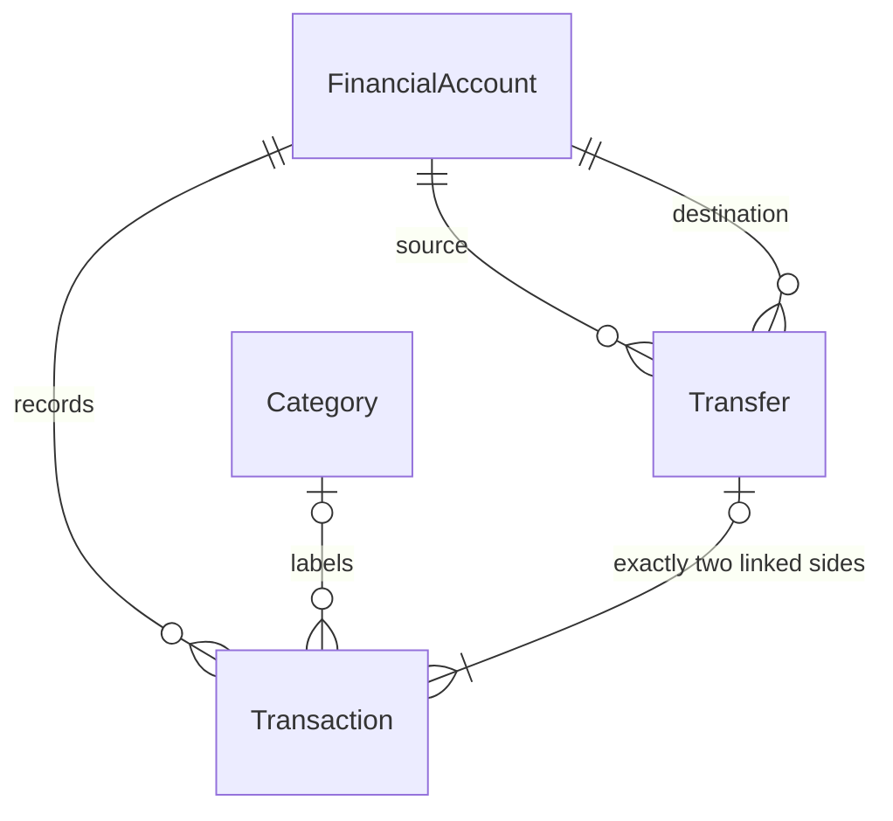

# Phase 1 data model

All financial records stay in local SQLite. The ledger is authoritative; there
is no editable or cached account-balance column.

## Accounts and categories

`financial_accounts`: UUID id, name, type, three-letter uppercase currency code,
optional institution, active flag, created_at, updated_at. Supported types:

| Type | Meaning in this phase |
| --- | --- |
| CHECKING | Everyday bank account |
| SAVINGS | Savings cash account |
| CASH | Physical cash |
| CREDIT_CARD | Signed balance; debt is negative |
| INVESTMENT | Account type only; cash ledger, no holdings or valuation |

Currency is required by the domain and immutable through account updates. BRL is
only a frontend/demo default. ISO-style codes are shape-validated; no external
currency registry, exchange rates, or per-currency minor-unit rules are implemented.
Account deletion deactivates it. Historical balances remain in dashboard totals,
and new postings/transfers to inactive accounts are rejected. Existing ordinary
entries can still be corrected or soft-deleted on an inactive account.

`categories`: UUID id, user-defined name, created_at, updated_at. Names are unique
case-insensitively after trimming. Categories are applicable to both income and
expense, with no hierarchy. A category cannot be deleted while referenced by any
transaction, including soft-deleted history. Foreign keys enforce this as well as
the API's explicit check.

## Monetary convention

Amounts use Python `Decimal` and the SQLAlchemy `ExactMoney` adapter. SQLite stores
24 zero-padded decimal digits of millionths as TEXT (not NUMERIC/REAL). This preserves
the former NUMERIC(24,6) range without 64-bit integer overflow. Values must be finite,
strictly positive, less than 10^18, and have at most six fractional digits. APIs
require decimal **strings**, rejecting JSON numbers rather than risking float
conversion. Excess precision is rejected before persistence, not silently rounded.
Responses serialize money as strings; the frontend formats those strings directly.

Every transaction and transfer stores currency. Composite foreign keys tie it to
the referenced account's currency. No aggregation combines different currencies.
The UTCDateTime adapter restores UTC timezone information on SQLite reads; transaction dates are calendar dates with no
timezone conversion.

## Transactions and opening history

`transactions`: UUID id, account_id, transaction_type, positive amount, currency,
direction, transaction_date, description, optional merchant/category_id, optional
transfer_id, created_at, updated_at, and nullable deleted_at.

| Type | Direction | Income/expense reporting |
| --- | --- | --- |
| INCOME | IN (+) | Income |
| EXPENSE | OUT (-) | Expense |
| TRANSFER | IN or OUT according to linked side | Excluded |
| OPENING_BALANCE | IN for assets, OUT for a starting liability | Excluded |

An account creation may specify nonnegative `opening_balance`, `opening_direction`
(IN by default), and an explicit opening date. A nonzero amount creates one opening
entry atomically with the account. Zero creates no ledger entry, because ledger
amounts must be positive. A partial unique index permits at most one opening entry
per account. There is no independently editable starting-balance field.

Opening entries and transfers are immutable through both the API and database
update/delete triggers. Correcting or reversing them is intentionally deferred.
Ordinary entries can change type (income/expense), amount, date, description,
merchant, and category; their account and currency cannot be reassigned. Updates
retain id/created_at and advance updated_at, but a full revision audit is not yet
implemented. Deleting an ordinary entry sets deleted_at, preserves the row, and
excludes it from balances, lists, and reporting. Retrieve-by-id can still inspect it.
Physical transaction deletion is blocked by a database trigger.

## Transfers

`transfers`: UUID id, source_account_id, destination_account_id, positive amount,
currency, date, description, created_at, updated_at, source_entry_id, and
destination_entry_id. The entry IDs are deferred foreign keys to transactions. A transfer links exactly two
transactions through transfer_id: OUT on the source and IN on the destination.

The dedicated backend operation reserves the SQLite writer before reading accounts,
inserts the parent and both entries in one transaction, and commits once. Same-account
and cross-currency transfers are rejected. Composite foreign keys require matching
account currencies. Parent entry pointers must resolve at commit; insert triggers
validate that each side exactly matches its parent. Unique `(transfer_id, direction)`
and distinct entry ID constraints prohibit extra sides. Partial or mismatched
transfers cannot commit, including through direct database writes. All failures roll
back the whole operation. Negative balances remain valid; overdraft prevention is
not imposed.

The frontend exposes transfers only through Transactions -> Add Transaction ->
Transfer. The dedicated `/api/transfers` endpoint remains an atomic backend boundary,
not a separate product section. Categories are managed in Settings. Their stored
`normalized_name` is generated from lower(trim(name)) and uniquely indexed; this
keeps duplicate-name enforcement introspectable by SQLite/Alembic.

## Balances and dashboard

Python aggregates decoded Decimal values (never SQLite floating-point SUM).
For each account, sum non-deleted IN amounts minus non-deleted OUT amounts across
**all recorded dates**, including future-dated entries, for the Phase 1 accounts and
dashboard endpoints. The new history endpoint instead calculates as-of-date balances.
Legacy dashboard total account value is the sum of all-date balances,
including inactive accounts and signed credit-card liabilities, grouped by currency.
INVESTMENT accounts contribute their ledger cash balance only.

The retained `/api/dashboard` endpoint accepts a selected month as `YYYY-MM`.
Overview now uses `/api/history` instead.
The backend includes dates from that month's first day (inclusive) to the next
month's first day (exclusive). Only INCOME contributes to income and only EXPENSE
contributes to expenses. Both opening entries and transfers are excluded. Recent
transactions contain up to ten non-deleted ledger entries, including both transfer
sides. Listing supports basic filters and limit/offset pagination.

Mandatory example: Checking opening 5,000 + income 1,000 - expense 200 - transfer
500 = **5,300**. Savings opening 2,000 + transfer 500 = **2,500**. Reporting is
**1,000 income**, **200 expenses**; the transfer changes neither report total.

## API surface

All paths are under `/api`. IDs are UUIDs. Monetary request/response values are strings.

| Method | Path | Operation |
| --- | --- | --- |
| GET / POST | `/accounts` | List with calculated balances / create with optional opening |
| GET / PUT / DELETE | `/accounts/{id}` | Retrieve / update metadata and active flag / deactivate |
| GET / POST | `/categories` | List / create |
| PUT / DELETE | `/categories/{id}` | Rename / delete when unreferenced |
| GET / POST | `/transactions` | Filtered list / create INCOME or EXPENSE |
| GET / PUT / DELETE | `/transactions/{id}` | Inspect / correct ordinary entry / soft-delete |
| POST | `/transfers` | Atomically create a linked pair |
| GET | `/transfers/{id}` | Inspect the transfer relationship |
| GET | `/dashboard?month=YYYY-MM` | Currency-separated balances and monthly totals |

Transaction filters: `account_id`, `transaction_type`, `category_id`, `date_from`,
`date_to` (both inclusive), `limit` (1–200, default 100), `offset` (default 0).
PUT requests replace the documented editable fields; omitted optional merchant or
category fields clear them. Errors use 404 for missing records, 422 for invalid
input/unsupported currency operations, and 409 for immutable/referenced records or
constraint conflicts. Database exception details are not returned to the browser.

See FastAPI `/docs` for complete request and response schemas.

## Historical display (Phase 1.6)

`GET /api/history?period=1M|3M|YTD|1Y|ALL&end=YYYY-MM-DD` is read-only.
1M begins on the first of the ending month; 3M and 1Y include respectively three
and twelve calendar months; YTD starts January 1; ALL starts at the earliest retained
entry. The end date is inclusive. Baseline is the closing balance on the day before
the period. Points are emitted on activity dates and at the end, with unchanged
balances carried forward between them. Overview renders a monotone visual curve;
preview charts retain step rendering. Interpolated geometry is not additional financial
history: displayed amounts always use exact closing ledger values. Both transfer sides are applied
before emitting the day's point. Missing accounts have zero reconstructed balance.

Each currency series includes baseline, closing balance, income, expenses, net flow,
absolute change, optional percentage change, and expense-only category totals.
Percentage change is omitted when the baseline is zero or negative. Opening balances
can affect balance change but never flow totals, so these metrics need not match.
Soft-deleted and later-dated entries are excluded. Account metadata is current, not
historically versioned. Includes inactive accounts and signed credit-card debt.
No currencies are combined or converted. Recent activity contains up to eight entries
inside the selected range, including both linked transfer sides where applicable.

`demo_fixtures` (`sqlite_0002`): string version id, start_date, end_date, JSON payload.
This optional record marks the deterministic synthetic seed and holds only clearly
fictional UI illustrations. All monetary JSON values are decimal strings. Budget
category IDs identify labels for comparison only, not a budget-domain relationship.
Preview holdings are not `FinancialAccount` assets and never participate in balance
calculation. GET `/api/demo` returns `enabled: false` on an ordinary workspace.
There is no preview write API or automatic seeding.
