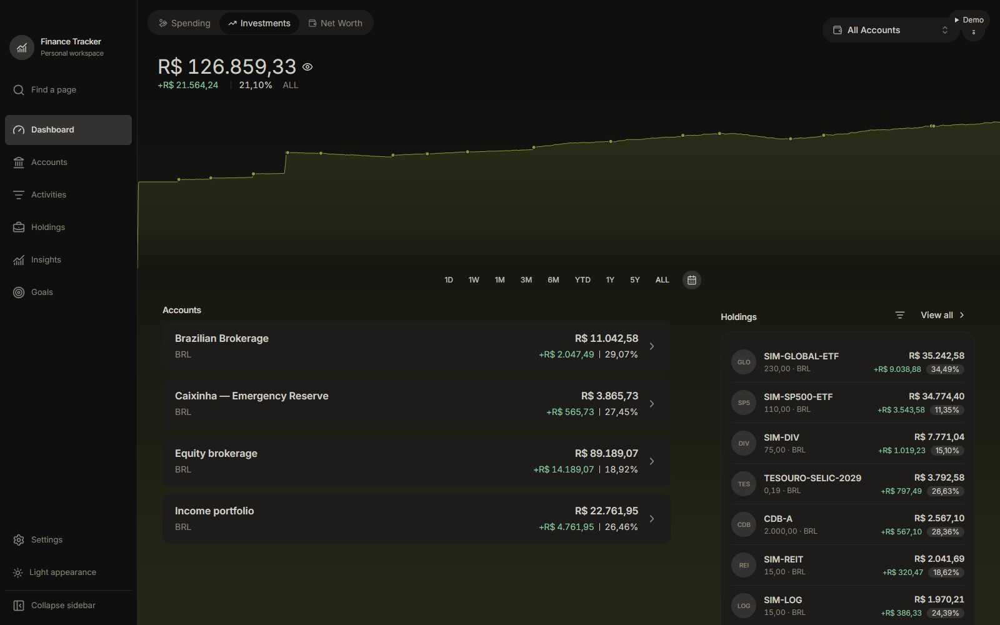
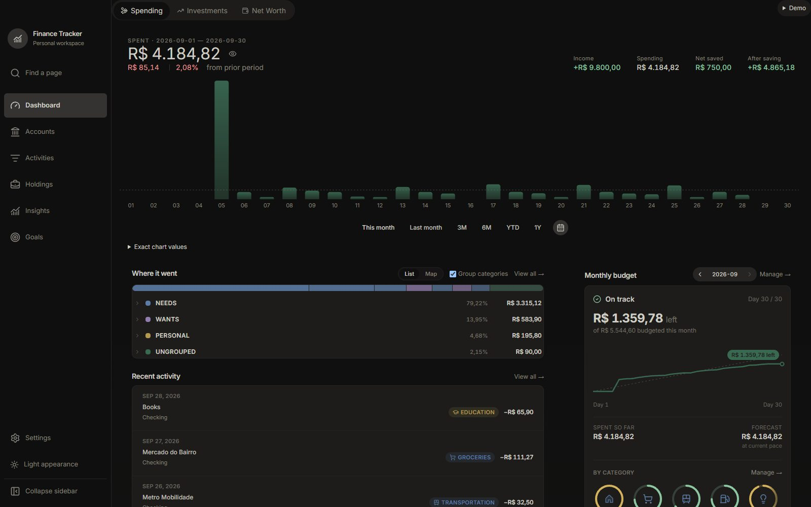
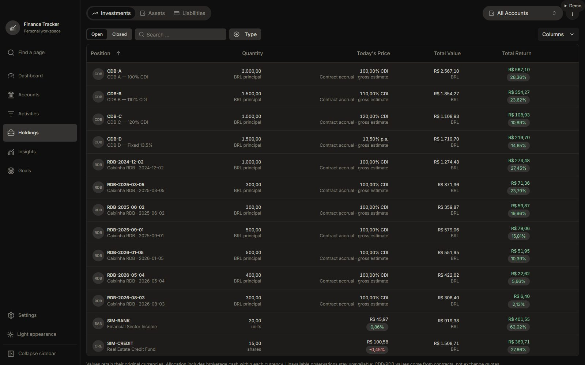
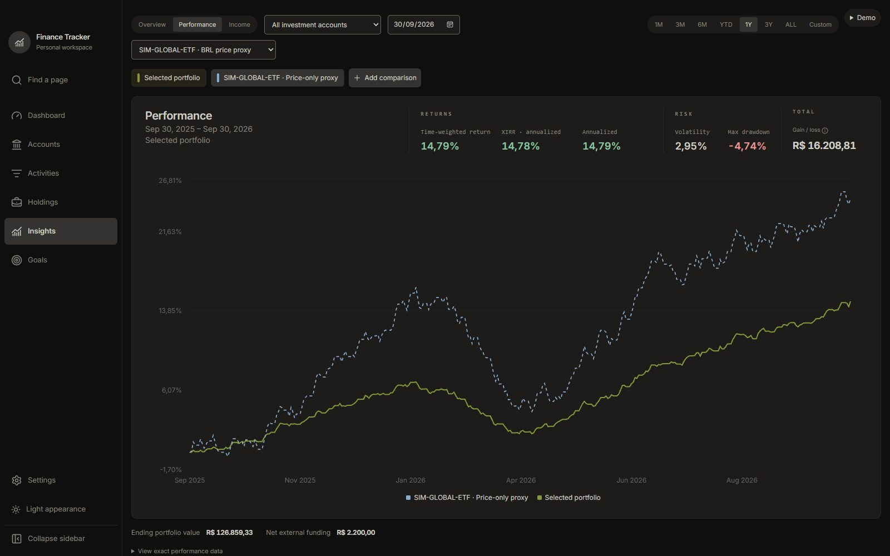
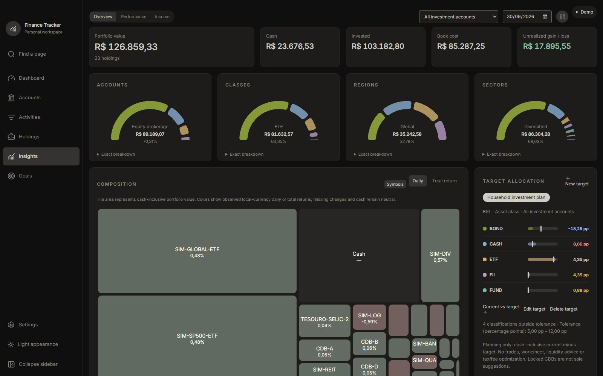
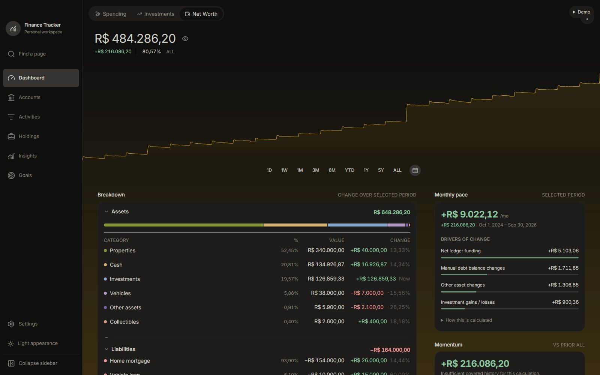
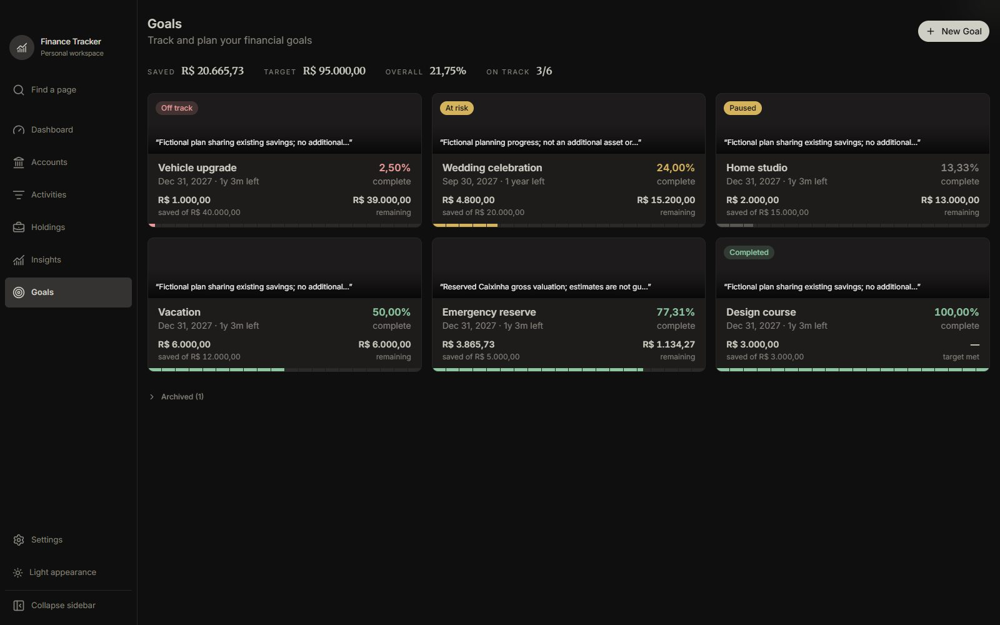
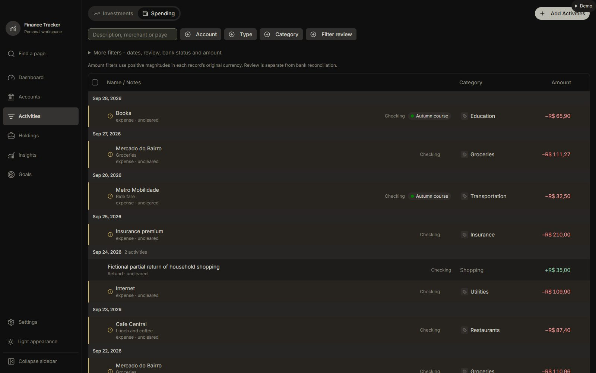
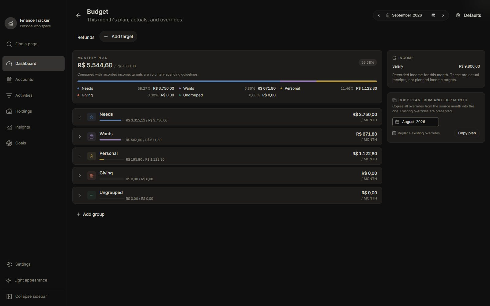
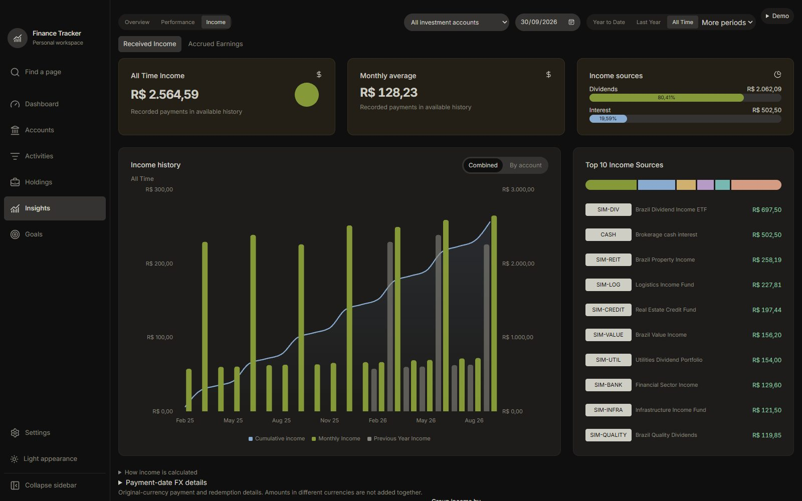

# Finance Tracker v0.14 gallery

Real application captures, November 21, 2026. Classic dark / Inter / English,
1600 × 1000, 100% zoom. All financial records are fictional, from a fresh owned
unified demo ending September 30, 2026. Official CDI/Treasury inputs and simulated
SIM observations retain separate provenance. This is not real investor performance.

| View                 | Preview                                                                 | What it demonstrates                               |
| -------------------- | ----------------------------------------------------------------------- | -------------------------------------------------- |
| Investments overview | [](investments.jpg)                      | Portfolio value, accounts and holdings             |
| Spending             | [](spending.jpg)                               | Spending, categories and monthly budget            |
| Holdings             | [](holdings.jpg)                               | Activity-derived securities/fixed income           |
| Performance          | [](performance.jpg)                      | TWR with a labeled fictional price-only comparison |
| Portfolio Insights   | [](portfolio-insights.jpg) | Allocation and concentration                       |
| Net Worth            | [](net-worth.jpg)                            | History and assets/debts                           |
| Goals                | [](goals.jpg)                                        | Progress and lifecycle states                      |
| Activities           | [](activities.jpg)                         | Transaction ledger and review                      |
| Budgets              | [](budgets.jpg)                                  | Monthly targets and rollover                       |
| Income               | [](income.jpg)                                     | Posted income history and sources                  |

[Download/play the actual browser walkthrough](walkthrough.webm) ·
[Narration and click-by-click guide](../../PORTFOLIO_WALKTHROUGH.md) ·
[Capture manifest](capture-manifest.json)

The clip is 115 seconds / 3.3 MB, silent VP8/WebM at 1280 × 800 / 12 fps. The written guide supplies
narration. Download and open in Chrome/Edge/Firefox. MP4 was not produced because
the available Playwright FFmpeg helper only supports WebM recording.

## Reproduce the gallery

Install/build the frontend and sync the backend as described in the
[main README](../../../README.md#try-the-complete-fictional-demo). From `frontend/`:

```sh
npx --no-install playwright install ffmpeg
node scripts/portfolio-capture.mjs --record
```

Installed Edge is the default. Set `BROWSER_CHANNEL=chrome` for installed Chrome,
or install Playwright Chromium and use `BROWSER_CHANNEL=chromium`. Default port:
5174; set `PORTFOLIO_PORT=8001` for the other approved free loopback port. PowerShell
example: `$env:BROWSER_CHANNEL='chrome'`.

The runner refuses occupied ports, creates `.tmp/portfolio-v014-*` and never
attaches saved or personal data. No live integrations, reset or financial writes
are used. It waits for API/chart/font readiness, captures viewport JPEGs, and checks
browser/API errors, financial totals and unchanged accounts. No mockups or reference
screenshots are used. Only reviewed final media/guides/manifest are allowlisted;
raw frames, logs, databases and local validation stay ignored. Inspect size/privacy
before staging regenerated media. This does not replace normal CI or repeat the
previous 42-screen visual campaign.

The published clip trims five initial loading seconds and uses Playwright's existing
FFmpeg helper to scale/encode the real recording (`scale=1280:800`, 12 fps,
`libvpx`, 400k target bitrate). An ordinary `--record` run produces the untrimmed
1600 × 1000 version; it does not require a separate editor. Never overwrite the
input with the same encoder output path. The public manifest records the published
clip's actual duration, dimensions, size and adjusted scene-entry times.
